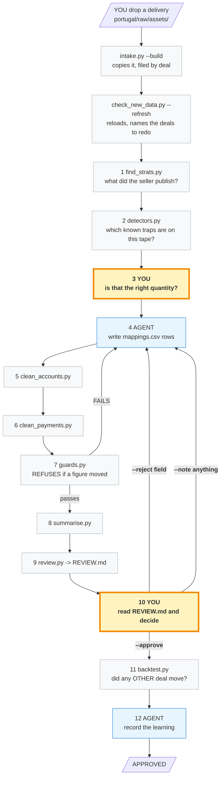

# Pre-registration benchmark

Turns a seller's diligence tape into a dataset somebody can defend, with the
evidence attached. One folder per stage of the loan's life; this is the half
BEFORE the loan reaches our systems. The half after is
`../post-registration-benchmark/`.

    uv run python scripts/run.py PT15020

That runs every deterministic step and stops where judgement is needed.
Read `WORKFLOW.md` for the diagrams, `METHOD.md` for the detail.

## The workflow, and where YOU come in

Four steps need a human. Everything else is deterministic and runs itself.
The thick boxes are yours.

| who | does | how often |
|---|---|---|
| **YOU** | decide if the seller's figure is the right quantity | once per deal |
| **YOU** | read REVIEW.md, reject what is wrong, note what you want answered, approve the rest | once per deal, plus once per rejection |
| AGENT | write registry rows; answer a rejection or a note; record what the deal taught | whenever you send something back |
| the engine | everything else - parse, join, net, measure, refuse | every run |

**Nothing downstream may treat a deal as checked until you approve it.**
`run.py` exits 3 at step 10 and will keep doing so. A guard failure or an open
rejection goes back to the AGENT, never past you.

## What is where

**Shared by every country** - no country-specific RULE lives up here, and that
is the point. Deal names do appear, in comments and in `null_means`, as the
evidence for a rule; what must never appear is a fact that is only true in one
jurisdiction. Those go in `<country>/CONTEXT.md` (T57):

    README.md  METHOD.md  WORKFLOW.md     how this works
    CONTEXT_TEMPLATE.md                   the shape every CONTEXT.md follows
    schema.yaml                           THE contract: a fixed core + an open
                                          long table. The SAME core everywhere,
                                          or two books cannot be compared
    traps.yaml                            every SELLER-TAPE failure mode met
                                          so far (52). A decimal comma is
                                          not Portuguese
    engine-lessons.yaml                   the 23 lessons about OUR OWN
                                          pipeline, review and conduct. Split
                                          out 2026-10-13 so the file read once
                                          per deal is only about tapes. The
                                          recurring five are compressed into
                                          the agent definition
    scripts/                              ALL the code - the engine and the
                                          loaders both. No country-specific
                                          LOGIC: every rule holds for any
                                          seller. Deals ARE named, in
                                          comments, as the evidence for why
                                          a rule exists - a rule whose
                                          origin nobody can check is folklore
    scripts/intake.py                       assets/ -> processed/files/
    scripts/load_tapes.py                   processed/files/ -> tables/
    scripts/check_new_data.py               what changed since the last load
    scripts/paths.py                      the ONLY place a country is named,
                                          and the only place the deal pattern
                                          is built - from COUNTRY_OF, so
                                          adding Spain needs no other edit

**No country folder contains code.** `portugal/raw/` holds `assets/` and
`processed/` and nothing else; the three loaders used to live inside it and
derive their paths from their own location, which made `raw/` half code and
hard-wired `PT\d{5}` into three separate files.

**Per country** - one folder, everything about that country inside it:

    portugal/
      raw/
        assets/             DROP A DELIVERY HERE, exactly as you received
                            it, in whatever folder shape it came in. This is
                            the ONLY folder anybody edits by hand, and
                            nothing in this pipeline ever writes to it,
                            renames inside it, or deletes from it
        processed/          everything derived from assets/, and nothing else
          files/<DEAL>/       the same workbooks, copied and filed by deal.
                              What a person opens
          tables/<DEAL>.parquet  the same CONTENT, parsed: one row per cell.
                              What every script reads. Re-reading 180
                              workbooks takes two minutes; this takes
                              milliseconds. A parse cache, not a second copy
      excluded.yaml         files we HOLD but have decided not to use, with
                            a reason. The decision lives in a file and not in
                            a folder, because processed/ gets rebuilt
      CONTEXT.md            facts true of EVERY deal in this country, and the
                            rulings somebody made - insolvency and bankruptcy
                            being one thing in Portugal, for instance. Kept
                            here and never in the shared engine, so the next
                            country cannot inherit a legal opinion (T57)
      bridge.sql            the warehouse half of the seller-to-prod bridge
      OVERVIEW.md           what this country's deliveries are and what the
                            bridge matches
      cleaned/              what this pipeline produced
        accounts/             one row per LOAN, 20 fixed columns
        additional_attributes/  one row per loan per FACT
        payments/             one row per payment, signed
      cleaning-context/<deal>/  CONTEXT.md, REVIEW.md, decisions.yaml,
                                cleaned_summary.md
      mappings.csv          THE registry. One row per column per deal
      deals.csv             seller, country, cut-off, completion
      strats/               what the seller published, and what reproduces it
      backtest-baseline/    the fingerprint every run is compared against

Adding a country is **one new folder and one line** in `COUNTRY_OF` - no code
changes. The country is derived from the deal code (`PT15018` is Portuguese
because it begins `PT`), never configured, because a setting that says which
country we are working on is a setting that will be wrong one day and wrong
silently.

**Raw and cleaned sit side by side and the names say which is which.** The
practical test: anything under `cleaned/` can be rebuilt by running the
pipeline. Nothing under `raw/` can be rebuilt by anybody.

## New data arrives

    1  drop the delivery in portugal/raw/assets/   any shape, any depth
    2  intake.py                                   dry run, says what it would do
    3  intake.py --build                           copies it, filed by deal
    4  check_new_data.py --refresh                 parses, names the deals to redo
    5  scripts/run.py <DEAL>                       for each one it named

**Only step 1 touches `assets/`, and only you do it.** Steps 2-5 read it and
write somewhere else. Delete `processed/` and steps 3-4 rebuild it from
scratch; delete `assets/` and the data is gone. Everything is arranged around
that one asymmetry.

The deal code is found by `PT\d{5}` ANYWHERE in the path or filename, so a
data room can ship `2026-01 delivery/PT20014/asset index/` one month and
`PT20014_tranche2.xlsx` the next. Nothing needs renaming to be understood.

Nothing is ever overwritten. Identical bytes are copied once and the repeat
is reported. The same NAME with different bytes is a new VERSION: both are
kept and the engine refuses to choose, because replacing a tape silently
would change a deal's population and stale its approval without anyone
seeing. A file with no deal code is reported and left exactly where it is -
guessing which book it belongs to is worse than saying so.

!! assets/ IS ORGANISED BY DELIVERY, NOT BY DEAL, AND THAT IS THE POINT.
   An earlier version of intake MOVED files out of a landing folder and gave
   each one a `PT#####/` parent, so the delivery as sent stopped existing the
   moment it was filed. Two deliveries' worth of files were left in one flat
   deal-first tree with no way to tell which arrived when.
   Both have been put back under the names they were sent as:

       assets/PT - Orange - Asset Index/   179 files, delivered 2026-01-14
       assets/PT - Orange - Extract/        19 files

   The Extract's shape is proven: releasing it showed it held deal folders,
   flat. The Asset Index's membership is proven too - when the Extract was
   released, thirteen of its files were reported as ALREADY HELD, which is
   only possible if the earlier delivery had already brought them in.
   What is NOT recoverable is any nesting the Asset Index had ABOVE its deal
   folders. If it had any, it is gone.
   It cannot happen again: intake copies now, and nothing writes to assets/.

All of it is loaded. There is no holding area: a file nobody loads is a file
nobody can see, and the question a hold was waiting on - *is this the same
book?* - is one the pipeline now answers itself.

The 19-file `PT - Orange - Extract` delivery is the worked example. Thirteen
files were byte-identical to what we already held, so they were copied once
and the repeats reported. The other six were loaded, and the engine sorted
them out:

    PT20008   `Portefolio OneyBank_30.06.2020.xlsx` is the SAME 2,905
              accounts as the asset index, row for row, EUR 5,751,844.33
              either way. Dropped as a duplicate block and the fuller copy
              kept - the asset index carries 33 columns to its 28, including
              the insolvency dates. This deal maps no loan_id, so the
              comparison is a row FINGERPRINT, not an id set (trap T54).
    PT15020   `..._cleaned_aux.xlsx` turned out to be OUR OWN output -
              columns `cutoff_principal`, `cutoff_fv`, `country`,
              `reflect_id`. It had already put four phantom "published"
              figures into the strat scanner, every one matching the book
              perfectly, because the book is where they came from. Recorded
              in `excluded.yaml` and flagged by detector T55.
    PT15016   `Barclay Cons V1.xlsx`, a `Sale file` sheet of 98 columns.
              Loaded; no sheet the registry maps, so the deal is unchanged.
    PT18019   three `..._Ruby_PT_v3.xlsx` files. Loaded; unmapped, so the
              deal is unchanged - **and this one is a decision waiting for
              you**, see below.

All four deals came back to the figure they had before. Nothing moved.

### PT18019 is worth a look

Its three new files are 35 columns in the STANDARD WiZink format, 32,406
rows, at cut-off 201809. The deal is built today from `Closing_data.xlsx`:
24 columns, no published figure, no client id, no judicialisation flag. The
v3 tape even carries an `exclu_reason` column, which might give that deal the
scope rule it does not have.

Switching to it is a registry change, not a file move - the files are already
loaded. It would change that deal's population and stale its approval, so it
is yours to call, not something to do quietly.

### If an extract turns out to be wrong

Somebody says a delivery was bad. Replace the file in `assets/` with the
corrected one, then:

    intake.py --build              copies the correction into processed/
    check_new_data.py --refresh    re-parses, names the deal
    scripts/run.py <DEAL>          re-cleans it

The md5 ledger spots the change by content, so nothing depends on the file
being renamed or dated. If the corrected file has the same NAME as the old
one, both are kept and reported as competing versions - say which is wrong in
`excluded.yaml`, or which supersedes in `mappings.csv` with a `prefer` row.
Neither decision is one the engine will make on its own, and neither is
stored in `processed/`, which gets rebuilt.

## Proving the folder rebuilds

`scripts/reproduce.py` re-runs each deal and compares the output to what is
on disk. That proves the engine is deterministic. It does **not** prove the
folder is reproducible, because it builds into the tree that is already
there.

The test that does:

    find portugal/raw/processed -type f -delete
    find portugal/cleaned -type f -delete
    find portugal/raw/processed portugal/cleaned -depth -type d -empty -exec rmdir {} \;

    scripts/intake.py --build
    scripts/check_new_data.py --refresh
    scripts/run.py <DEAL>              for all twelve

Run 2026-10-11 from `assets/` alone: 180 files, 316 sheets, 265,850 rows, and
all 29 cleaned outputs came back **byte-identical**. It found one real defect
first - every output folder was created with `mkdir(exist_ok=True)`, which
makes the leaf and assumes the parent, so nothing could build into an empty
tree and all twelve deals failed at once (T56). That folder existed only
because somebody had made it by hand months earlier.

Two things are NOT rebuilt by this and must not be deleted:

    processed/tables/bridge.parquet   comes from Snowflake, via
                                      bridge.sql - not from assets/
    cleaning-context/<deal>/decisions.yaml   your rejections and approvals

The rebuild leaves both alone; it was checked.

## The review

Twelve deals are cleaned and none is approved. The model is **reject until
approve**: challenge what looks wrong, ask what you want answered, and
approving signs off everything left.

    scripts/review.py <DEAL> --reject <field> "what is wrong"   # back to the agent
    scripts/review.py <DEAL> --note "not about one field"       # back to the agent
    scripts/review.py <DEAL> --approve                          # signs off the rest

An approval pins three things: every field's mapping, the raw tape's md5 and
the output's md5. Change any one and the sheet says which, and the signature
is void. A signature may never outlive what it signed.

## Is it right?

Four checks, all of which must be green, and all of which have caught real
defects in this work:

    scripts/cases.py        25 regression cases, each from a defect that happened
    scripts/reproduce.py    every deal rebuilds byte-for-byte from the same inputs
    scripts/backtest.py     no value moved on a deal you were not working on
    scripts/verify.py       which deals are approved, and whether the signature
                            still covers what is on disk

`cases.py` also checks that METHOD.md, WORKFLOW.md and the agent file still
describe the code, and that the generated documents on disk are current - both
of which had silently drifted within a day of being written.
