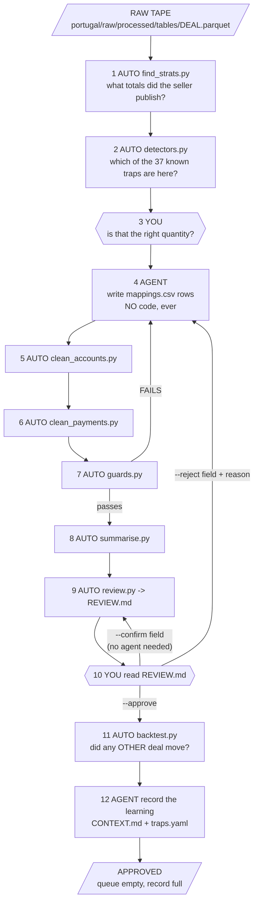
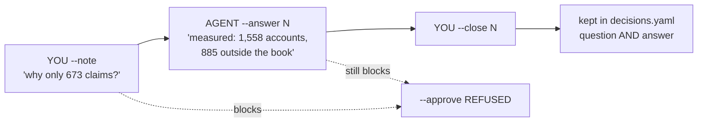
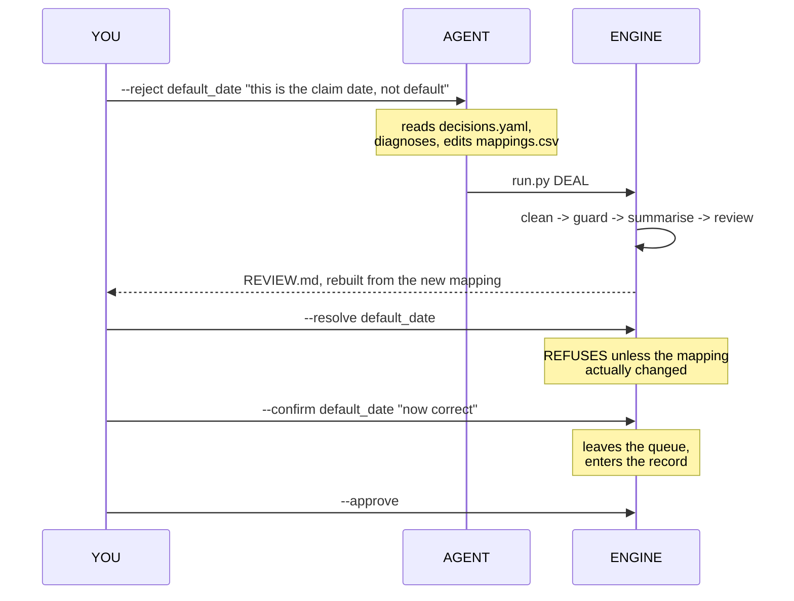
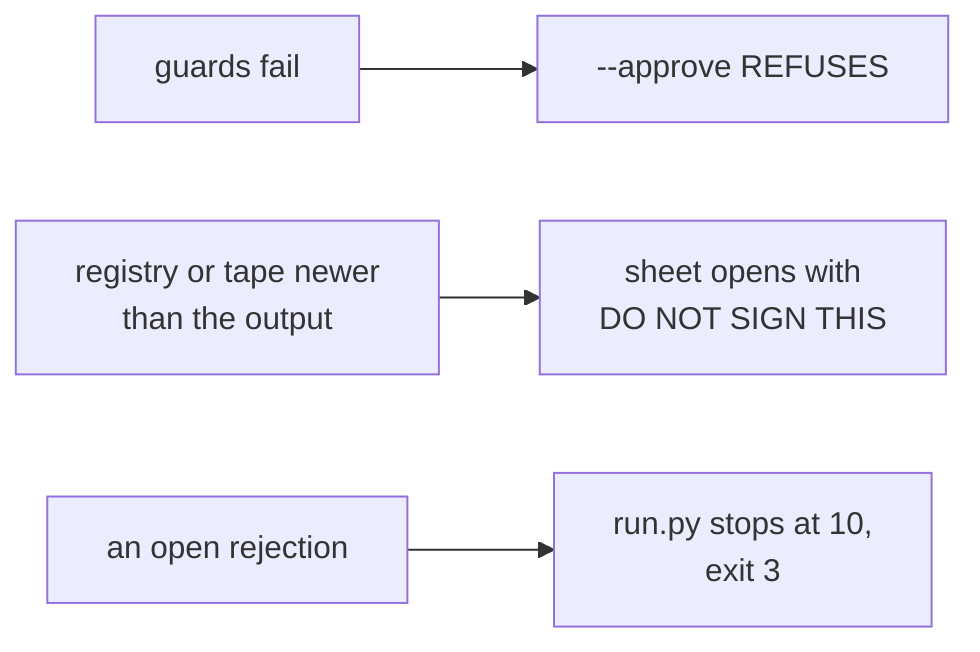
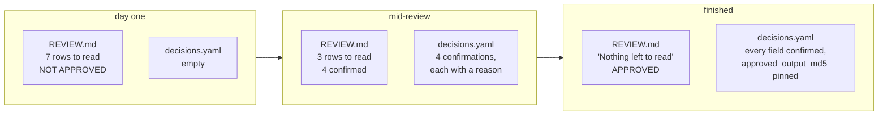
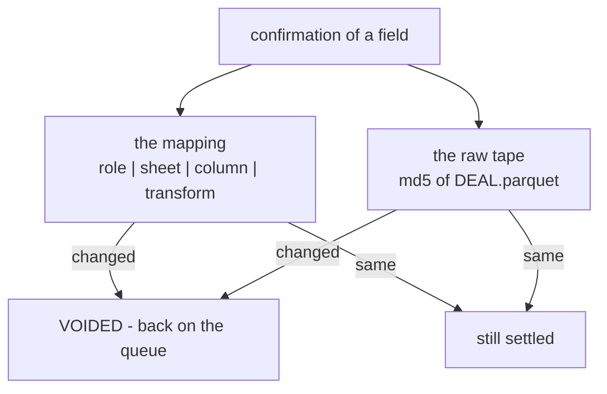

# How a seller tape becomes an approved dataset

One page. The sequence, who does what, and what "finished" looks like.

Run it with `uv run python scripts/run.py <DEAL>` from this folder.

## The sequence

**Yes - a rejection goes back to the AGENT.** That is the whole loop. You
reject a field with a reason, the reason lands in `decisions.yaml`, and the
agent reads it, changes the registry row, and the deal rebuilds from step 5.
You never edit a mapping yourself and the agent never overrules a rejection.

A failing guard goes to the agent too, and for the same reason: a guard
failure is a mapping problem or a new trap, never something to be waved
through.

A **confirm** is the one action that does NOT involve the agent - nothing
about the data changed, so only the sheet is regenerated.

## Two ways to say something, one loop

Not everything a reviewer thinks is about one field. "Is this the right
month?" and "why do only 673 of 32,529 loans carry a claim?" belong to the
deal, not to a row in a table.

Every judgement row on the sheet carries a **why this column** cell, taken
from the registry note - so a decision someone measured does not look like a
guess:

    | field            | <- column        | filled | why this column            |
    | `cutoff_balance` | `curr_bal`       | 100%   | what is owed NOW, not the  |
    |                  |                  |        | balance frozen at charge-off|
    | `client_id`      | `Cliente Number` | 100%   | the only id on this book    |
    |                  |                  |        | that reaches prod (64%)     |

**The model is REJECT UNTIL APPROVE.** You are not ticking a checklist. You
challenge what looks wrong, ask what you want answered, and approving signs
off everything left in one action.

| you have | you use | goes to | blocks approval |
|---|---|---|---|
| this FIELD is wrong | `--reject <field> "reason"` | agent | yes |
| anything not about one field | `--note "whatever"` | agent | yes |
| nothing left to challenge | `--approve` | - | it IS the sign-off |
| (optional) a field settled early | `--confirm <field> "why"` | nobody | no, it just clears that row |

Approving is as traceable as ticking every row would have been, because it
PINS every field's mapping plus the raw tape. Change one mapping afterwards
and the sheet says exactly which:

    **What changed since you signed:**
    - `product_type` -- was `base | ANEXO_I_DADOS | Produto | text`,
                        now `base | ANEXO_I_DADOS | FaseRecup | text`
    **APPROVED-STALE.**

A note follows the same three steps as a rejection, so there is one thing to
remember:

`--close` refuses on an unanswered note. Closed notes stay on the sheet with
their answers, because a closed question with no visible answer is just a
deleted question.

## Who does what

| | does | never does |
|---|---|---|
| **the engine** | parses, joins, nets, measures, refuses | decide what a column MEANS |
| **the agent** | writes registry rows, diagnoses a failing guard, records learnings | write code to make a deal pass; set verification_status |
| **you** | confirm meaning, reject what is wrong, approve | have to re-check anything arithmetic already settled |

## Three gates you cannot get past

And `--resolve` refuses unless the mapping actually changed. If the mapping was
right and the rejection was mistaken, `--anyway "why"` records it as
`unchanged: true` so the trail shows a withdrawal, not a fix.

## What "finished" looks like

The review sheet is a QUEUE, not a report. It empties as the work is done.

So the end state is exactly as you described it: **the review empties and the
decision record fills.** An empty section 3 means every mapping is either
settled by arithmetic or confirmed by a human, with a reason, in writing.

## What makes a confirmation stick

Each confirmation pins TWO things, and is VOID if either moves:

The approval pins a third thing: the md5 of the output file it signed. If the
output moves afterwards the sheet reads **APPROVED-STALE** and shows both
hashes. A signature can never outlive what it signed.

## Where everything lives

    RAW      portugal/raw/assets/                      YOU drop a delivery here,
                                                       in whatever shape it came
             portugal/raw/processed/files/<DEAL>/      intake.py --build copies it
             portugal/raw/processed/tables/<deal>.parquet   one row per cell
             portugal/raw/processed/tables/payments.parquet       all deals, per cell

    CLEAN    portugal/cleaned/accounts/<deal>.parquet   one row per LOAN,
                                                    20 FIXED columns
             portugal/cleaned/additional_attributes/    one row per loan per FACT:
                                                    deal_id, loan_id,
                                                    column_name, column_value,
                                                    column_type
             portugal/cleaned/payments/<deal>.parquet   one row per payment, SIGNED
             *.meta.json                            seller, measure, coverage,
                                                    and every row-level
                                                    decision the engine made

    The core is a promise every consumer relies on; the long table absorbs
    whatever a seller ships without widening the table for eleven other deals.
    A new FACT is a registry row. A new CORE column re-runs everything and
    stales every approval.

    RECORD   cleaning-context/<deal>/CONTEXT.md    the judgement calls, by hand
             cleaning-context/<deal>/REVIEW.md     the open queue, generated
             cleaning-context/<deal>/decisions.yaml your signatures, generated
             traps.yaml                            52 SELLER-TAPE failure modes
             engine-lessons.yaml                   23 lessons about OUR pipeline.
                                                   Not read per deal
             scripts/cases.py                      35 regression cases

## Why this is reproducible

Every run rebuilds from the same four inputs and is checked three ways:

- `reproduce.py` rebuilds each deal to scratch and compares MD5 byte for byte
- `backtest.py` fingerprints every column of every deal, plus the payments
  totals, and reports any value that moved on a deal you were not working on
- `cases.py` re-runs 29 defects that have actually happened here

A change to shared code that moves another deal shows up before it reaches you.
